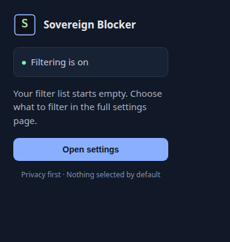
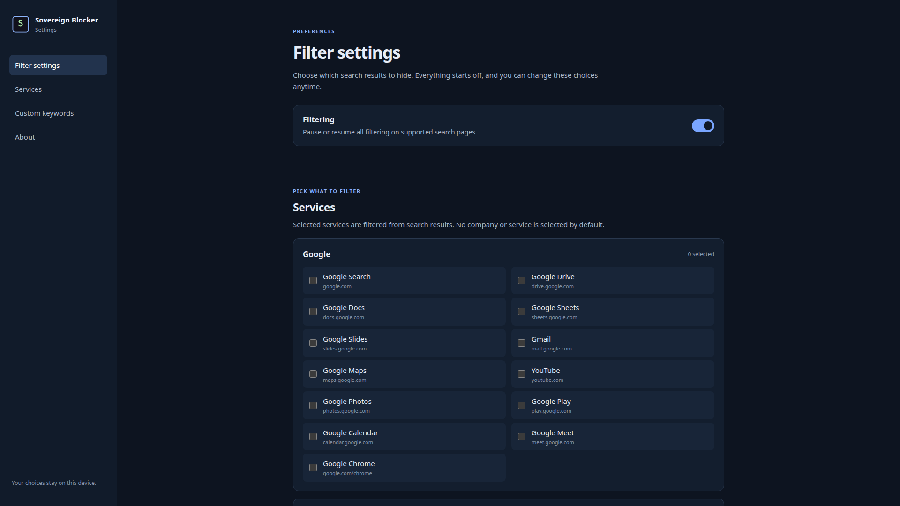
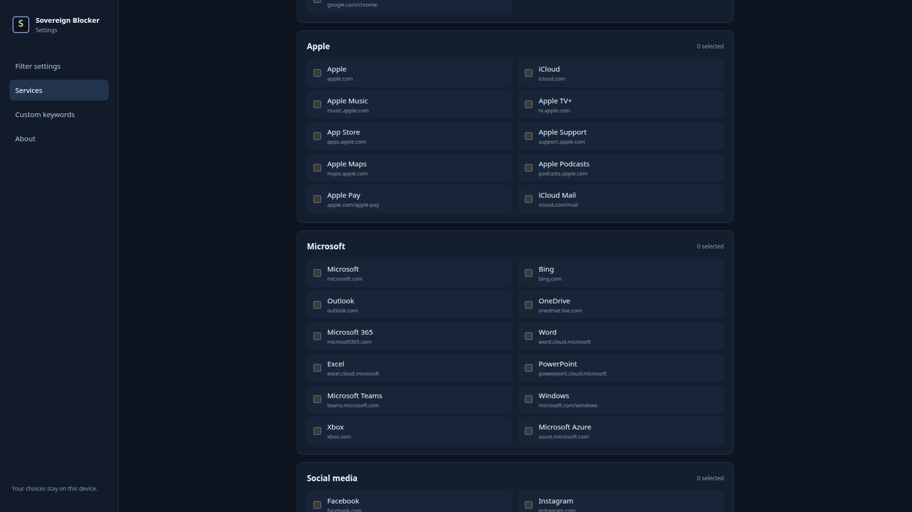
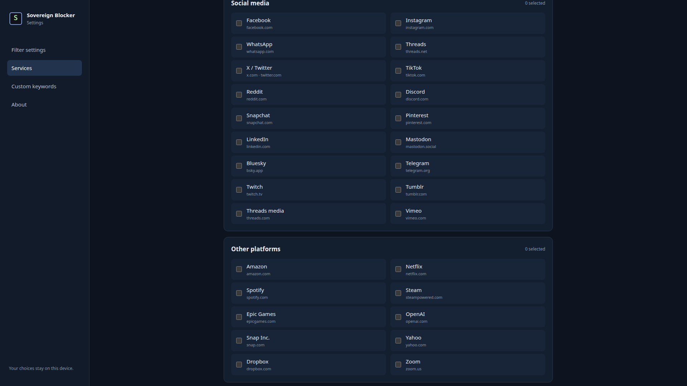
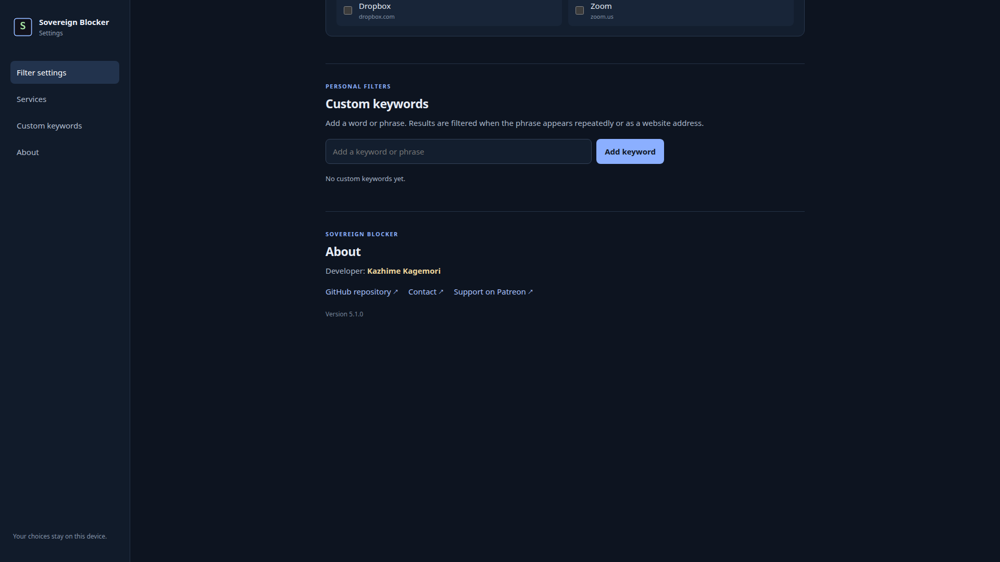

# Sovereign Blocker

A Firefox extension for filtering selected services from search results. Nothing is filtered until you choose a service or add a custom keyword.

## Features

- Full-page settings for Google, Apple, Microsoft, social media, and other services.
- Optional custom keyword filters.
- Toolbar popup with status and a shortcut to settings.
- Filtering runs locally on supported search result pages.

## Install for development

1. Open `about:debugging` in Firefox.
2. Select **This Firefox** and choose **Load Temporary Add-on…**.
3. Select this folder's `manifest.json` file.

Temporary add-ons are removed when Firefox closes. For a regular Firefox installation, submit the extension to [Firefox Add-ons](https://addons.mozilla.org/) and distribute the signed package returned by Mozilla.

## Build contents

The extension source is in the repository root. The `.gitignore` excludes generated `.xpi` and `.zip` packages; build release packages from the source files when needed.

See [CHANGELOG.md](CHANGELOG.md) for the project changelog and [FIREFOX_ADDONS_NOTES.md](FIREFOX_ADDONS_NOTES.md) for the Firefox Add-ons release text.

## Screenshots

### Toolbar popup

### Full-page settings

The settings page is shown in four consecutive 1920 × 1080 screenshots:

1. 
2. 
3. 
4. 

## License

This project is distributed under the terms in [LICENSE](LICENSE).
